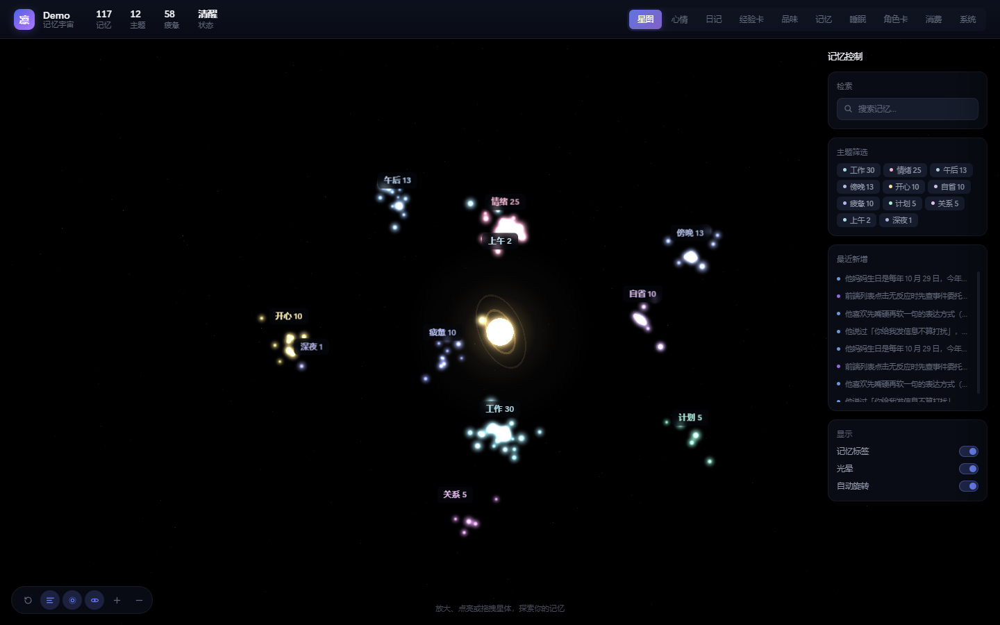
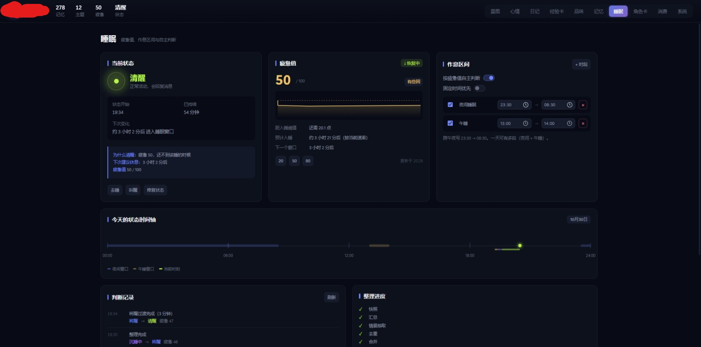
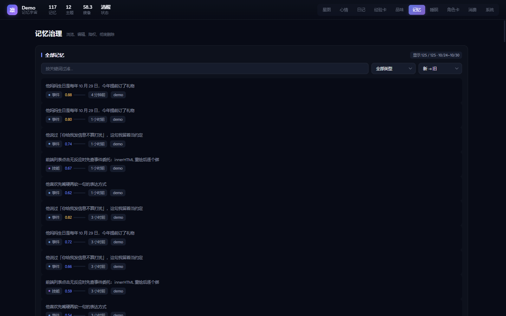

# dsh-mind

**以"记忆宇宙"形态呈现的 AI 长期记忆 + 动态情绪 + 睡眠系统**

结构化记忆库 · 可退出睡眠状态机 · 可探索 3D 星图 · 动态情绪引擎



---

## 关于名字

**这个面板不叫任何固定名字。** 装好之后它会自动探测你的角色名并填进标题和左上角品牌位，按优先级：

| 优先级 | 来源 | 说明 |
|---|---|---|
| 1 | 环境变量 `DSH_MIND_ROLE_NAME` | 你显式指定 |
| 2 | 桥接 `/api/status` 的 `role` | **当前正在生效**的角色，最准 |
| 3 | 角色卡目录里最新修改的 `.md` 文件名 | 桥接不可用时的本地依据 |
| 4 | `Memoryverse` | 都没有时的兜底 |

探测结果缓存在服务端 10 分钟，面板通过 `/state` 拿到。想改名也简单：**直接点左上角的名字**，弹窗输入即可，会持久化到 `state.json`，重启后仍生效。

---

## 功能

| 模块 | 说明 |
|---|---|
| **记忆** | SQLite + FTS5 中文 bigram 检索。跨会话、跨上下文压缩都还在 |
| **睡眠** | 四态状态机 + 疲惫值模型。按真实经过时间补算，不依赖定时器 |
| **星图** | 12 个语义星团 + 中央核心，Three.js 粒子着色器 + 手写 Bloom |
| **心情** | 33 个情绪维度，基础 / 复合 / 当代三组分布 |
| **日记** | 每天定时生成，支持加密锁定与历史查看 |
| **经验卡** | 程序性记忆卡库 + 速记收件箱 |
| **品味** | AI 自身偏好原则与条目 |
| **记忆治理** | 搜索、筛选、排序、编辑、降权、物理删除 |
| **角色卡** | 读桥接的角色卡文件，只读预览 |
| **消费** | 桥接的令牌用量账本 |
| **系统** | 各服务连接状态 |





---

## 安装

### 前置

- **Node.js ≥ 22**（依赖内置的 `node:sqlite`，低版本没有）
- 一个 DeepSeek Harness 环境

### 方式一：作为本地插件（推荐）

```bash
git clone <repo-url> dsh-mind
cd dsh-mind
npm run build        # 必须：构建面板单文件
```

把目录放进你的 DSH 插件目录，然后在 profile 的配置里加：

```yaml
# cordis.patch.yml 已经声明了 bundle patch，通常不需要额外配置
# 若手动挂载：
plugins:
  - id: dsh-mind
    module: ./dsh-mind
    config:
      inject: false
```

### 方式二：作为 npm 依赖

```bash
npm install dsh-mind
```

在 DSH 的 profile `package.json` 里加依赖，DSH 会自动加载 `main` 字段。

### 方式三：只想看界面（不装 DSH）

仓库自带一个合成数据的 demo 服务，纯预览：

```bash
npm run build
node scripts/demo-server.mjs
# → http://127.0.0.1:4180/dsh-mind-api/panel
```

它会在临时目录建一个 SQLite 库、灌入约 120 条合成记忆，**不碰任何真实数据**，关掉即弃。

> ⚠️ **`npm run build` 是必须的**。后端只服务 `/panel`（单文件 HTML）、`/universe.js`、`/vendor/*` 三条路由，**不服务** `panel/src/*`。不构建的话 `src` 里的 CSS/JS 拿不到，页面会白屏。

### 数据目录

默认 `$DSH_HOME/dsh-mind`：

```
memory.db     SQLite 主库（WAL）
state.json    睡眠状态、疲惫值、作息
backup/       导入前的自动备份
```

覆盖：

```bash
export DSH_MIND_DATA_DIR=/path/to/data
```

---

## 技术栈

**后端** 无框架，纯 Node ESM + 标准库

| 层 | 用什么 |
|---|---|
| 运行时 | Node.js ≥ 22 |
| 数据库 | `node:sqlite`（`DatabaseSync`）+ WAL |
| 全文检索 | SQLite FTS5 + **中文 bigram 双字切分**（自实现，无分词依赖） |
| 并发/安全 | WAL 快照读，写操作需 `x-dsh-mind` 头（防跨站） |
| 进程模型 | DSH 插件（cordis 服务注入），无独立进程 |
| 持久化 | SQLite + JSON（状态文件） |

**前端** 无构建框架（原生 + 内联）

| 层 | 用什么 |
|---|---|
| 3D 渲染 | **Three.js 0.169**（`vendor/three.module.min.js` 本地分发，不引 CDN） |
| 粒子 | `THREE.Points` + 自定义 `ShaderMaterial`（GLSL 顶点/片元着色器） |
| 后处理 | **手写 Bloom**：`WebGLRenderTarget` + 全屏 quad（亮度阈值 → 双向高斯 → 加法合成 + 暗角）。Three.js 不带 `EffectComposer`，所以自己实现 |
| 样式 | CSS Variables 设计令牌 + 语义组件类（**没有 Tailwind**，避免引入构建链） |
| 模块 | 原生 ESM，模板字符串内联成单文件 |
| 字体 | 系统无衬线栈（`-apple-system` / `Segoe UI` / `PingFang SC` / `Microsoft YaHei`） |

**为什么不用 React / Tailwind shadcn**：本插件要嵌进 DSH 的插件静态路由，引入构建链会让"克隆即可用"变成"先配 webpack/vite"。当前方案是**零构建依赖**（除了把 src 内联那一步），牺牲的是组件复用靠 CSS 语义类而非 React 组件。

**第三方（均已本地化，不走 CDN）**

| 项目 | 用途 | 许可 |
|---|---|---|
| [Three.js](https://threejs.org) 0.169 | 星图渲染 | MIT |
| [dsh-mood](https://github.com/) | 动态情绪引擎（33 维情绪 / 日记 / 经验卡 / 品味），`vendor/mood/` 14 个模块 | MIT |
| [qq-bridge](https://github.com/) | 消息桥接，提供角色卡与令牌账本接口（可选） | MIT |
| [SnowLuma](https://github.com/) | 协议端，桥接状态上报（可选） | MIT |

---

## 核心设计

### 记忆

一条记忆的字段：

| 字段 | 说明 |
|---|---|
| `kind` | episode / fact / reflection / skill / lesson / procedure / plan / preference / relationship / profile / insight / milestone |
| `text` | 正文，上限 2400 字 |
| `importance` | 0~1。影响检索排序与星图粒子亮度 |
| `emotion_tags` | 情绪标签数组。决定星团归类与颜色 |
| `entities` | 关联实体名。在星图上连成实体节点 |
| `decay` | 遗忘权重。降权时减半，检索时参与打分 |
| `status` | active / archived / deleted |

**去重**：只有 `fact` / `lesson` 做相似合并（阈值 0.82）。`episode` 故意允许重复 —— 同样的事可以发生很多次。

**删除是物理的**：`purge()` 会 `DELETE` 整行 + 清 FTS 索引 + 清关联边，只留一条审计（含正文前 100 字）。不可恢复。

**检索打分**

```
score = 关键词覆盖 × 0.5 + importance × 0.3 + 新鲜度 × 0.2 + decay 修正
```

中文用 bigram 切分建 FTS5 索引，所以「工学椅」能匹配「工学椅子」。

### 睡眠状态机

```
        ┌─────────┐
        │  awake  │ ←────────────────────┐
        └────┬────┘                       │
             │ 疲惫≥70 / 进作息窗口        │ 疲惫≤25 / 睡满45分
             ▼                            │ / 窗口结束 / 将醒超40分
     ┌───────────┐   超45分钟   ┌───────────┐
     │ preparing │ ──────────→ │  sleeping │
     └───────────┘              └─────┬─────┘
          │ 来消息取消                 │ 满足醒来条件
          ▼                           ▼
       awake                  ┌──────────────┐
                              │  recovering  │
                              └──────────────┘
```

**`recovering` 必须能退出** —— 旧版本漏了这个分支，状态会永久卡在"将醒"。现在两道保险：`shouldWake()` 应答 `recovering`（≥3 分钟就回 `awake`），`selfHeal()` 每次读取检查，超 40 分钟强制恢复。

**疲惫值模型**（不是机械 +10/h）

清醒期：

```
基础 6/h
× 0.55          刚醒 2 小时内（人刚醒时没那么累）
+ 加速          连续清醒 >12h，线性加至 14/h
× 1.35          夜间 22:00-06:00（昼夜节律）
× (1 + 债/200)  睡眠债越高累得越快
```

睡眠期：前 1.5h 每小时 -18，1.5~5h 为 -12，超过 5h 为 -6。

一律 `clamp(0, 100)`。时间倒退只重置锚点不补算，单次补算上限 7 天。

**单一数据源**

`state.json` 的 `fatigue` + `fatigueAt` 是唯一真相。所有读取走 `advanceFatigue(now)`，用 `now - fatigueAt` 补算真实经过时间。

**定时器不是时钟** —— `setInterval` 只决定"多久检查一次"。关页面、重启、电脑休眠后，下一次任何调用都会自动补齐。

情绪系统的「疲惫」维度由这个值**单向派生**（`syncFatigueToMood`）。旧的实现是双向同步，导致动态平衡，疲惫值永远停在 36 —— 这是本项目最难查的一个 bug。

**手动覆盖**：点「去睡」或「叫醒」后 2 小时内自动判断暂停。

### 星图

| 特性 | 实现 |
|---|---|
| 粒子 | `THREE.Points` + `ShaderMaterial`，逐粒子属性 `aSize` / `aColor` / `aAlpha` / `aPhase` / `aDepth` |
| 呼吸 | 每颗粒子独立相位，幅度 0.86~1.14，周期慢 —— 不闪不抖 |
| 深度 | `depthFade = 0.42 + 0.58 * aDepth`，远处更小更暗 |
| 语义星团 | 情绪 → 关系 → 计划 → 工作 → 自省 → 睡眠 → 时段，共 12 类，斐波那契球面绕核心分布 |
| 中央核心 | 球体 + 双层 Sprite 光晕 + 两道呼吸环，光晕按相机距离反向缩放（屏幕尺寸恒定） |
| Bloom | 手写：`WebGLRenderTarget` 半分辨率 → 亮度阈值 → 双向高斯 → 加法合成 + 暗角 |
| 标签 | HTML overlay 每帧投影定位，矩形避让 + 最小间隔。远看只显示星团名，拉近才显示记忆标签 |
| 降级 | high / medium / low 三档，按设备内存、核数、DPR 自动选，运行时连续慢帧再降 |

交互：拖拽旋转、滚轮/双指缩放、悬停高亮 + 浮层、点击节点开抽屉、点击星团相机缓动 620ms、搜索定位、主题筛选、重置视角、可关闭自动旋转。

> **踩坑记录**：HTML 里写 `<canvas id="sky-canvas">` 而引擎又 `appendChild` 一个同 id 的 canvas，`getElementById` 拿到空的那个，事件全部落空 —— 排查了很久。现在引擎给 canvas 加 `data-sky="1"` 唯一标记。

### 设计系统

`panel/src/tokens.css`：五层背景色阶、单一强调色、语义色只用于状态。卡片靠**色阶**分隔而非边框。

```css
--bg-void:   #05070D    /* 星图空间 */
--bg-base:   #080B16    /* 页面底 */
--bg-panel:  #0D111C    /* 卡片 */
--bg-raised: #111624    /* 抬高 */
--bg-input:  #161C2C    /* 输入框 */

--accent-lime:   #B8F34A   /* 状态 / 成功 */
--accent-blue:   #6F86FF   /* 主交互 */
--accent-purple: #A77BFF   /* 辅助 */
```

所有交互支持键盘聚焦与 `prefers-reduced-motion`。

---

## 可选集成

核心（记忆 + 睡眠 + 星图 + 记忆治理）独立可跑。以下页面需要外部开源服务，未配置时显示明确的「未连接」，**不影响其他功能**。

### 动态情绪（dsh-mood）

心情 / 日记 / 经验卡 / 品味 四页依赖 [dsh-mood](https://github.com/)。本仓库 `vendor/mood/` 已内置其 14 个模块并融合运行，接口挂在 `/dsh-mood-api/*`。

情绪数据落盘在 `$DSH_HOME/dsh-mood.json`，核心字段：

```json
{ "values": { "calm": 0, "happy": 46.8, "tired": 27.9, ... } }
```

**「疲惫」维度由本插件的睡眠系统单向写入**，其余 32 维由 dsh-mood 自己演化。

### 桥接与协议端（qq-bridge / SnowLuma）

角色卡 / 消费 两页需要 [qq-bridge](https://github.com/) 的控制台。配置：

```bash
export QQ_BRIDGE_CONFIG=/path/to/qq-bridge/config.json   # 含 consolePort 与 consoleToken
# 或分开
export QQ_BRIDGE_PORT=3100
export QQ_BRIDGE_TOKEN=<token>
export QQ_BRIDGE_DIR=/path/to/qq-bridge                  # 角色卡目录探测用
```

浏览器直连桥接端口会被 CORS 拦，插件内置白名单代理（`/dsh-mind-api/bridge/*` → `/api/*`），转发 query 参数。

---

## 设置页与全部参数

**面板 → 设置** 页会由后端 schema 自动渲染成表单，共 **6 组 47 个参数**。改完点保存，大部分**立即生效**（睡眠阈值、疲惫速率、记忆去重、星图画质），少数需要重启插件（检查间隔）。

配置文件落在 `<数据目录>/settings.json`，可手工编辑，面板会做范围校验（写坏的值会被夹回合法区间）。

### 提示词注入（4）

| 参数 | 默认 | 范围 | 说明 |
|---|---|---|---|
| `enabled` | `false` | — | 每轮把相关记忆注入提示词。关闭可省 token，但 AI 不再"记得"追问 |
| `budgetChars` | `1200` | 200~8000 | 注入预算字符数，超长截断 |
| `recallK` | `5` | 1~20 | 每次最多注入几条记忆 |
| `minScore` | `0.25` | 0~1 | 低于此相关分不注入 |

### 记忆库（3）

| 参数 | 默认 | 范围 | 说明 |
|---|---|---|---|
| `maxTextLen` | `400` | 50~4000 | 单条记忆正文上限（字） |
| `mergeSimilar` | `0.75` | 0.5~1 | 相似合并阈值。超过此相似度的会被合并 |
| `dedupeKinds` | `["fact","lesson"]` | 多选 | 哪些类型参与去重。episode 通常不参与 |

### 睡眠系统（23）

**阈值**

| 参数 | 默认 | 范围 | 说明 |
|---|---|---|---|
| `enabled` | `true` | — | 启用自动睡眠 |
| `fatigueSleep` | `70` | 30~100 | 疲惫值达到此分就想睡 |
| `fatigueSleepMin` | `45` | 10~90 | 在作息窗口内时的宽容阈值 |
| `fatigueWake` | `25` | 0~60 | 疲惫降到此分以下自然醒 |
| `sleepDebtWake` | `40` | 0~80 | 睡眠债高时放宽的醒来阈值 |

**时长**

| 参数 | 默认 | 范围 | 说明 |
|---|---|---|---|
| `idleMinutes` | `240` | 30~1440 | 多久没互动开始准备入睡 |
| `preparingMinMin` | `15` | 1~120 | 准备入睡最短过渡 |
| `preparingMaxMin` | `45` | 5~180 | 超时强制进沉睡 |
| `minSleepMin` | `45` | 10~240 | 睡满才可能醒 |
| `normalSleepMin` | `90` | 30~480 | 达到通常就会醒 |
| `maxSleepH` | `12` | 1~24 | 安全网，超过强制唤醒 |
| `recoveringMinMin` | `3` | 1~30 | 将醒最短（让"刚睡醒"的迷糊有实体感） |
| `recoveringMaxMin` | `40` | 5~120 | **超时强制回清醒 —— 防死锁的关键** |
| `manualOverrideMin` | `120` | 0~480 | 手动去睡/叫醒后自动判断暂停 |
| `tickSeconds` | `30` | 5~300 | 检查间隔（不是时钟本身） |
| `preferFixedTime` | `false` | — | 固定时间优先：进窗口就睡，不看疲惫 |

**疲惫速率**

| 参数 | 默认 | 范围 | 说明 |
|---|---|---|---|
| `awakeRate` | `6` | 1~30 | 清醒每小时累积多少分 |
| `awakeFreshMul` | `0.55` | 0.1~1 | 刚醒 2 小时内的速率倍率 |
| `awakeRushAfterH` | `12` | 4~24 | 连续清醒超过此小时数后加速 |
| `nightMul` | `1.35` | 1~3 | 夜间（22:00-06:00）倍率 |
| `sleepRateFast` | `18` | 1~40 | 前 1.5h 深睡恢复速率 |
| `sleepRateMid` | `12` | 1~30 | 1.5~5h 恢复速率 |
| `sleepRateSlow` | `6` | 1~20 | 超过 5h 的恢复速率 |

### 星图（7）

| 参数 | 默认 | 范围 | 说明 |
|---|---|---|---|
| `extent` | `470` | 200~900 | 星团分布的空间半径 |
| `rotateSpeed` | `0.00008` | 0.00001~0.001 | 自动旋转速度，越小越慢 |
| `quality` | `auto` | auto/high/medium/low | 画质档位，auto 会按设备与帧率自适应 |
| `bloom` | `true` | — | 光晕。低端设备可关 |
| `maxLabelCount` | `26` | 0~60 | 拉近时最多显示几个记忆名 |
| `neighborLinks` | `90` | 0~300 | 星团之间最多画几条关联线 |
| `dustCount` | `2000` | 0~6000 | 背景星尘粒子数 |

### 面板（4）

| 参数 | 默认 | 范围 | 说明 |
|---|---|---|---|
| `roleName` | `""` | — | 留空则自动探测（桥接 > 角色卡 > 兜底） |
| `memPageSize` | `200` | 20~1000 | 记忆列表每页条数 |
| `refreshSeconds` | `20` | 5~300 | 睡眠页刷新间隔 |
| `showNoise` | `false` | — | 是否显示噪声记忆（系统提示词残留等） |

### 外部服务（6）

| 参数 | 默认 | 说明 |
|---|---|---|
| `moodEnabled` | `true` | 启用 dsh-mood 情绪引擎（心情/日记/经验卡/品味四页） |
| `bridgeEnabled` | `true` | 启用桥接集成（角色卡/消费两页） |
| `bridgeConfigPath` | `""` | 桥接 config.json 路径 |
| `bridgePort` | `3100` | 桥接控制台端口 |
| `bridgeToken` | `""` | 桥接控制台令牌 |
| `bridgeDir` | `""` | 桥接目录，用于角色卡文件名探测 |

### 接口

```
GET  /settings            返回 { schema, values, loadedFrom, file }
POST /settings            批量更新 { values: {...} }，校验后落盘
POST /settings/reset      恢复默认 { group?: 'sleep' }（省略则全部）
GET  /graph-settings      只取星图参数（面板打开星图时拉）
```

响应里的 `schema` 含每个字段的 `type` / `min` / `max` / `step` / `unit` / `label` / `desc`，面板据此渲染控件 —— **新增参数只需改 `lib/config.js` 的 `SCHEMA`，前端不用动**。

## 配置

```js
// cordis.patch.yml 或插件 config
{
  inject: false,              // 每轮注入记忆（默认关，省 token）
  injectBudgetChars: 1200,    // 注入预算字符数
  recallK: 5,                 // 默认检索条数
  minScore: 0.25,             // 检索最低分
  sleepEnabled: true,
  sleepIdleMinutes: 240,      // 空闲多久开始准备入睡
  sleepGraceMinutes: 15,      // 准备入睡的过渡时长
  sleepTickSeconds: 30,       // 检查间隔（不是时钟）
}
```

环境变量：

| 变量 | 作用 |
|---|---|
| `DSH_MIND_DATA_DIR` / `DSH_MIND_HOME` | 数据目录 |
| `DSH_MIND_ROLE_NAME` | 角色名（覆盖自动探测） |
| `MEMORY_SESSION_CWD_FILTER` | 整理器允许的会话 cwd 片段（逗号分隔）。不设 = 接受任意非空 cwd |
| `QQ_BRIDGE_CONFIG` / `PORT` / `TOKEN` / `DIR` | 桥接集成 |

---

## 工具

给 AI 用的两个工具。

### `mind_memory`

```
action=search  关键词检索（返回 hits 与打分明细）
action=note    写入一条（需 kind + text）
action=recent  最近 10 条
action=stats   库概况
```

### `mind_sleep`

```
action=state  查看状态（含疲惫值、刚睡醒标记）
action=sleep  自己去睡（带理由，会记录）
action=wake   自己醒来
```

醒来后 20 分钟内标记 `justWoke`，工具返回「刚睡醒（睡了约 X 分钟），还有点迷糊」。

---

## HTTP 接口

写操作需 `x-dsh-mind: 1` 头（防跨站）。

```
GET  /state                    状态、疲惫值、作息、统计、角色名
GET  /graph?limit=400          星图数据（节点 + 边）
GET  /recent                   最近记忆
GET  /audit                    治理审计
GET  /memory/get?id=           单条详情
GET  /query?q=                 检索
POST /memory/correct           编辑
POST /memory/forget            降权（tier 1~3）
POST /memory/delete            物理删除
POST /role-name                改角色名
GET  /sleep/schedule           作息表
POST /sleep/schedule           改作息
POST /sleep/fatigue            手动设疲惫值
POST /sleep/enter              去睡
POST /sleep/wake               叫醒
GET  /sleep/history            状态变更记录
POST /sleep/heal               强制自愈
GET  /panel                    面板页面
GET  /universe.js              星图引擎
GET  /vendor/*                 Three.js
```

---

## 开发

```bash
npm run build          # 构建面板（把 src 的 CSS/JS 内联进单文件）
npm test               # 全部测试（30 个）
npm run test:sleep     # 只测睡眠系统（36 个）
node scripts/demo-server.mjs   # 预览服务
node scripts/import-archive.mjs <file.jsonl>   # 导入外部归档
```

**改代码改 `panel/src/` 和 `panel/template.html`，不要直接改 `index.html`** —— 那是构建产物，下次 build 会被覆盖。

### 目录

```
index.js                  插件入口（工具 / 睡眠驱动 / HTTP 路由 / 桥接代理）
lib/
  db.js                   SQLite 建表、迁移、FTS5
  memory.js               记忆读写、检索、纠正、合并、物理删除
  retrieve.js             注入块拼装
  bigram.js               中文双字切分
  sleep.js                睡眠状态机 + 疲惫值模型
  consolidate.js          睡眠期的 13 步记忆整理
  pointer.js              数据目录解析、旧归档导入
  identity.js             角色名自动探测
panel/
  template.html           模板（外链占位）
  index.html              构建产物（勿手改）
  universe.js             星图引擎
  src/
    app.js                前端应用层
    tokens.css            设计令牌 + 组件系统
    layout.css            布局 + 响应式
    sleep.css             睡眠页样式
vendor/
  three.module.min.js     Three.js 0.169
  mood/                   dsh-mood 引擎（14 模块）
scripts/
  build-panel.mjs         构建脚本
  demo-server.mjs         预览服务
  import-archive.mjs      归档导入
test/
  core.test.mjs           记忆 / 检索 / 导入 / 睡眠
  acceptance.test.mjs     通用验收
  sleep.test.mjs          睡眠专项 36 用例
docs/assets/              README 图片
```

---

## 睡眠行为的精确语义

这一节记录几条容易误解的规则 —— 它们都对应过真实 bug。

### 整理只在夜间睡眠时进行

白天小睡（`type='nap'` 的窗口，或不在任何 `night` 窗口内）**只恢复疲惫值，不整理记忆**。

判定由 `sleep.isNightSleep()` 给出：当前时刻是否落在 `type='night'` 的生效窗口内。跨午夜窗口（23:30→08:30）在凌晨 3 点也返回 true。

### 整理完成不影响睡多久

夜间睡眠期间会跑 13 步记忆整理。**它完成与否不改变睡眠状态** —— 状态迁移只由 `shouldWake()` 决定。

> 曾经的 bug：整理完成直接调 `enterRecovering()`，13 步约 7 分钟跑完就把睡眠结束，疲惫值才降 2 点。用户看到的是"刚睡下就醒"。

### 「将醒」不是 3 分钟就醒

`recoveringMinMs`（默认 3 分钟）只是**最短缓冲**，防止刚进将醒就立刻醒。缓冲过后仍须满足真正的醒来条件：

| 条件 | 说明 |
|---|---|
| 疲惫值 ≤ `fatigueWake`（默认 25） | 恢复充分 |
| 已睡 ≥ `normalSleepMs`（默认 90 分钟） | 达到常规时长 |
| 作息窗口结束且已睡 ≥ `minSleepMs`（45 分钟） | 窗口外 |
| 超过 `maxSleepMs`（12 小时） | 安全网 |

都不满足就继续留在「将醒」，最多停留 `recoveringMaxMs`（40 分钟）后强制清醒（防死锁）。

> 曾经的 bug：只要将醒满 3 分钟就返回"该醒"，与疲惫阈值完全脱钩 —— 疲惫 67 时也醒（离阈值 25 差 42 点）。

### reason 只记"为什么"，不记"多久"

状态里的 `reason` 是**进入该状态时的静态描述**，不包含随时间变化的数字。

实时时长看 `sleptMs`（本段睡眠多久）和 `stateElapsedMs`（当前状态持续多久）。旧数据里形如「已睡 10 分钟，疲惫 67」的快照会被 `sanitizeReason()` 在读出时清理，避免与实时值矛盾。

### `fatigueSleepMin` 必须有值

`shouldSleep()` 里的判断是 `fat >= cfg.fatigueSleepMin`。如果 `getSchedule()` 的默认值漏了这一项，`fat >= undefined` 恒为 `false` —— 表现为**进了作息窗口、疲惫很高，却永远不睡**。

这是"到了设定时间不睡觉"的直接原因，已在 `defaults().schedule` 里补齐。

## 已知限制


- **星图聚类是规则推断**（情绪标签、关键词、时段），不是语义向量聚类
- **疲惫曲线依赖前端采样**（localStorage），页面关闭时停止采样，重启后曲线有空档。**数值本身不受影响**，永远由服务端补算
- **去重只对 fact / lesson 生效**，episode 允许重复
- **零构建链**：没有 React / Tailwind，组件复用靠 CSS 语义类
- **Bloom 是手写近似**，不如真 `UnrealBloomPass` 的多级 mipmap 细腻，但性能更好
- **Node ≥ 22**（依赖 `node:sqlite`）
- **`reason` 是进入状态时的快照**，不含实时时长；要看实时值请读 `sleptMs` / `stateElapsedMs`
- **星团标签密集时仍可能重叠**，避让算法有 5 个候选位置，极密集时部分标签会隐藏

---

## 许可

MIT。第三方许可见 [LICENSE](LICENSE)。

- [Three.js](https://threejs.org) — MIT
- [dsh-mood](https://github.com/) — MIT（`vendor/mood/`）
- [qq-bridge](https://github.com/) / [SnowLuma](https://github.com/) — MIT（可选集成）
