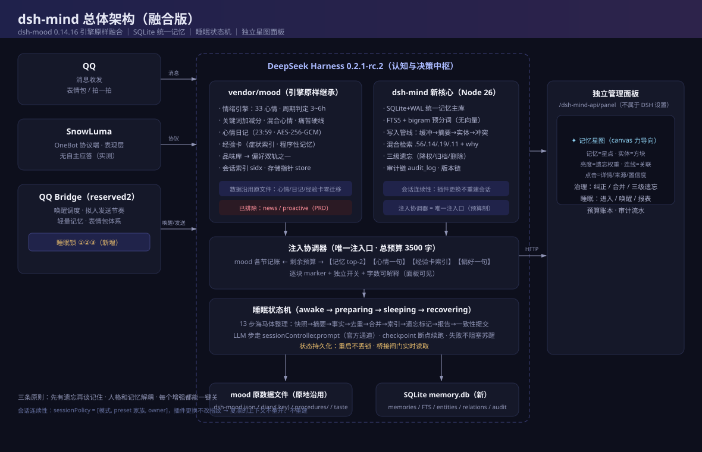
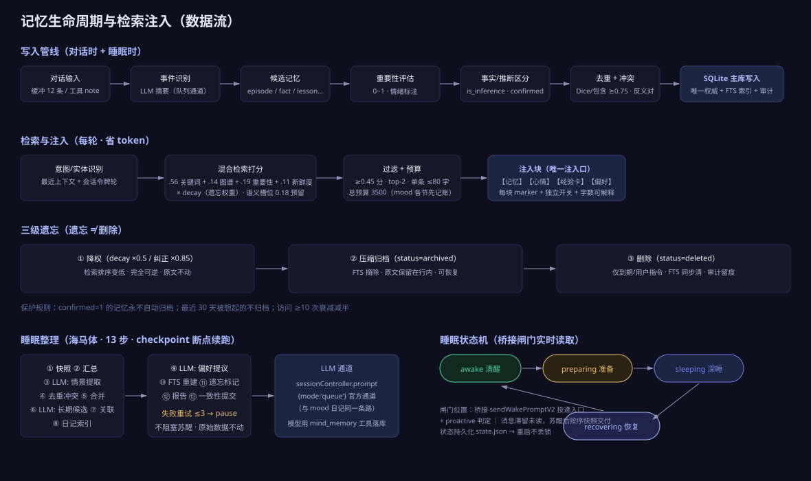

<div align="center">

# dsh-mind

**DeepSeekHarness 拟人化陪伴插件 · 统一记忆 / 动态情绪 / 睡眠认知 / 记忆星图**

`v0.1.0-alpha.1` · MIT · Node ≥ 24 · DSH ≥ 0.2.1-rc.2 · 零运行时依赖

由 [dsh-mood](https://github.com/JMX-4869/dsh-mood) 0.14.16 **融合分叉**而来：心情引擎、心情日记、经验卡、品味库原样继承；
新增 SQLite 统一记忆核心（FTS5 bigram，无向量）、三级遗忘、注入协调器、睡眠状态机（海马体整理）、独立记忆星图面板。

[架构总览](docs/assets/architecture.svg) · [数据流](docs/assets/dataflow.svg) · [总体审查报告](docs/REVIEW.md) · [技术栈](docs/TECH_STACK.md)

</div>

---

## 一、这是什么

给基于 DeepSeekHarness + SnowLuma + QQ Bridge 的拟人化 AI 陪伴体（如"大肥鱼"类 QQ 机器人）装上一套**可持续成长的认知系统**：

- **统一记忆**：本地 SQLite 单库（唯一权威），五种记忆（事件 episode / 事实 fact / 反思 reflection / 技能 skill / 道理 lesson）+ 经验卡（程序性）+ 情绪事件；中文 bigram 全文检索 + 实体图谱 + 重要性/新鲜度混合打分；**无向量依赖**。
- **动态情绪**：继承 dsh-mood 的 33 心情引擎（周期判定 3~6h、关键词加减分、混合心情、真实痛苦硬线），心情/日记数据**沿用原文件零迁移**。
- **睡眠认知**：四态睡眠状态机（清醒→准备→深睡→恢复），深睡期间 13 步海马体整理（断点续跑、幂等、失败不阻塞苏醒），睡眠锁在**桥接消息链路**真实拦截唤醒。
- **记忆星图**：独立管理网页（不属于 DSH 设置模块）——canvas 力导向星图（记忆=星点、实体=方块、连线=关联、亮度=遗忘权重），点击即查看/纠正/合并/遗忘，全部实时来自主库。
- **注入协调器**：全插件唯一提示词注入口，总预算 3500 字（mood 现状 +500），逐块 marker + 独立开关 + 字数可解释。

## 二、总体架构



三层职责（实测代码确认）：

| 层 | 职责 | 明确不做 |
|---|---|---|
| **dsh-mind**（DSH 内） | 统一记忆/情绪/日记/经验卡/偏好/睡眠/星图/mind_* 工具 | QQ 收发、主动消息调度、时事新闻 |
| **QQ Bridge** | 消息收发、唤醒调度、拟人节奏、白名单守卫、**睡眠锁执行点（3 插桩）** | 理解记忆语义 |
| **SnowLuma** | OneBot 协议端 + 表现层（无自主应答，实测确认） | 一切认知行为 |

## 三、记忆数据流



写入原则：只存"以后用得上的"，一条一句话；推断（`is_inference`）不得无确认转事实；相似 ≥0.75 自动合并（版本链留痕）；冲突标反义对。
检索原则：关键词为主力（中文实测结论）、图谱/重要性/新鲜度辅助；**遗忘三级**（降权→压缩归档→删除）永不直删原文，confirmed=1 永不自动归档。

## 四、安装与切换（融合替换 dsh-mood · 保会话不重开）

> 会话连续性保证：插件更换**不改变 sessionPolicy**（模式 + 预设家族 + owner），
> DSH 会话与桥接 state 不重建；mood 的心情状态/日记/经验卡/品味**沿用原数据文件**，
> memory 归档拷贝式导入 SQLite（源文件零改动、自动备份）。

```powershell
# 1) 停桥接
# 2) 桥接 config.json 的 socialV2 段加一行（睡眠锁落点，替换安装必填）：
#      "mindStatePath": "C:\\Users\\41588\\Documents\\dsh-web-home\\dsh-mind\\state.json",
# 3) 安装 dsh-mind + 移除 dsh-mood（⚠️ 先设 DSH_HOME，装错主目录是历史踩过的坑）：
$env:DSH_HOME = "C:\Users\41588\Documents\dsh-web-home"
dsh plugin --profile web add C:\Users\41588\Documents\dsh-mind
dsh plugin --profile web remove dsh-mood
# 4) 启动 DSH → 启动桥接
# 5) 验证：QQ 问她一件几天前的事；浏览器开 http://127.0.0.1:3080/dsh-mind-api/panel 看星图
```

**灰度纪律**：`inject` 默认 `false`（只写不读）——即使完成切换，提示词注入也是关闭的，
建议先跑 1~2 天（写入侧积累 + 面板核对数据质量），再把 cordis.patch.yml 的 dsh-mind 行加 `config: { inject: true }` 开注入。

## 五、配置

配置写在 profile 的 cordis.patch.yml 里 dsh-mind 行的 `config`（没有就用默认值）：

| 键 | 默认 | 说明 |
|---|---|---|
| `inject` | `false` | 注入总开关（灰度） |
| `injectBudgetChars` | `3500` | 注入总预算（= mood 现状 +500，用户指定） |
| `recallK` | `2` | 每轮注入记忆条数 |
| `recallMinScore` | `0.45` | 注入分数门槛 |
| `memoryMaxChars` | `80` | 注入时单条截断 |
| `importMoodArchive` | `true` | 首启把 mood 归档 jsonl 拷贝式导入 SQLite |
| `dataDir` | `$DSH_HOME/dsh-mind` | 数据目录（SQLite / 状态 / 备份） |
| `blocks` | `{}` | 注入分块开关 `{memory, mood, procedures, profile}` |

桥接侧（qq-bridge）新增：`socialV2.mindStatePath`——睡眠锁 state.json 路径，**留空 = 睡眠锁不启用**。

## 六、工具

| 工具 | 能力 |
|---|---|
| `mind_memory` | search / note / get / correct / forget（三级）/ recent——结构化长期记忆 |
| `mind_sleep` | 查看睡眠状态与整理进度（进入/唤醒由系统与面板管理） |
| `memory` | **同名继承** mood 的记忆工具，已重指向 SQLite（夏凛零适应成本） |
| `mood` / `diary` / `taste` | 原样继承（心情 / 加密日记 / 品味库） |

## 七、管理面板

独立网页：`http://127.0.0.1:3080/dsh-mind-api/panel`（不属于 DSH 设置模块）。
记忆星图（canvas 力导向：星点大小=重要性/访问频度、亮度=遗忘权重、连线=实体/情绪/共现关联）+
点击节点的治理抽屉（纠正/合并/三级遗忘，全留审计）+ 睡眠控制（进入/唤醒/报表/checkpoint）+ 预算账本与审计流水。
写操作带 `x-dsh-mind` 自定义头（跨站写保护）。

## 八、数据目录

```
$DSH_HOME/dsh-mind/
├─ memory.db          # SQLite 主库（唯一权威）
├─ state.json         # 睡眠状态机（桥接睡眠锁读取）
├─ backup/<ts>/       # mood 归档导入前的自动备份
└─ …（mood 原数据文件仍在 $DSH_HOME 原位：dsh-mood.json / diary / procedures/ / taste …）
```

## 九、开发与测试

```sh
node --test test/*.test.mjs        # 32 用例：核心 14 + 装配 2 + 验收 16（PRD 十五条映射）
node scripts/…                     # （预留）评估集 recall@1/@3 脚本位
```

- 无向量（用户决策）：模糊转述靠「写入时实体抽取 + 工具内置换词重查提示」兜底；v1.1 用评估集数据决定是否加本地小模型向量。
- LLM 依赖：写入摘要与睡眠整理的 LLM 步走 `sessionController.prompt` 官方通道；通道缺失时自动延后，不阻塞。

## 十、回滚

卸载 dsh-mind → 重装 dsh-mood 0.14.16 → 重启。mood 数据文件全程只被读取/拷贝，从未被写坏；
SQLite 独立目录可整删；桥接睡眠锁由 `mindStatePath` 控制，留空即失效。预计 10 分钟内完成。

## 十一、已知限制与活体待测

- 无向量：模糊转述查询存在长尾缺口（已用别名扩展+换词重查压缩，量化见审查报告）。
- 活体待测（PRD 允许标注）：连续对话情绪平滑度、睡眠锁端到端、苏醒积压顺序、整理任务在真实 LLM 下的质量。
- 上游分叉：dsh-mood 后续更新需手动合并（fork 自维护）。

## 十二、致谢

- [dsh-mood](https://github.com/JMX-4869/dsh-mood)（JMX-4869，MIT）——本插件的情绪引擎与工程基线
- [DSH-agent-procedures](https://github.com/MiHjy12138/DSH-agent-procedures)（MIT）——经验卡机制来源
- 「鱼的记忆」六层框架手册与 memory_brain 方案——检索权重、治理表与评估方法的参考
- [DeepSeekHarness](https://github.com/deepseek-ai/deepseek-harness) 插件生态

## 许可

MIT
